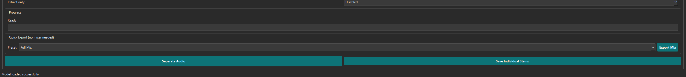

# TrachSplitter

> AI-powered audio stem separation and mixing — powered by Meta's [Demucs v4](https://github.com/facebookresearch/demucs).

Split any song into isolated stems (vocals, drums, bass, guitar, piano, other), mix them with per-stem volume/mute/solo controls, apply EQ & effects, and export — all from a single desktop app.

---

## Screenshots

> **Separation tab** — load a file, pick a model, separate in one click.


> **Editing & Mixing tab** — Mute / Solo / Volume per stem, presets, EQ, effects, live preview.


> **Quick Export** — pick a preset and export directly from the Separation tab without touching the mixer.



---

## Features

| Feature | Detail |
|---------|--------|
| **7 Demucs models** | htdemucs, htdemucs_ft, htdemucs_6s, hdemucs_mmi, mdx, mdx_extra, mdx_q |
| **Up to 6 stems** | Vocals · Drums · Bass · Guitar · Piano · Other |
| **Karaoke mode** | Extract a single stem vs. everything else |
| **Stem mixer** | Per-stem Volume · Mute · Solo · 5-band EQ |
| **Quick presets** | Full Mix · Instrumental · Vocals Only · Drums+Bass · Ambient |
| **Stem mixer extras** | Per-stem constant-power Pan · Fade in/out · Normalize to target dB |
| **Effects** | Compression · Reverb · De-noise (spectral gate) |
| **In-app playback** | Play stems and mix previews inside the app with click-to-seek and live playhead (system player still available) |
| **Track analysis** | BPM, musical key, and loudness detection (GUI + `cli.py analyze`, optional click track) |
| **Spectrogram viewer** | Waveform + frequency spectrogram per stem with drag-to-select and **Export Selection** |
| **Workflow** | Drag & drop loading · Recent files · Settings persist across restarts |
| **Batch CLI** | Separate entire folders from the command line |
| **GPU acceleration** | CUDA (NVIDIA) or CPU fallback |

---

## Download

Pre-built binaries (no Python required):

| Platform | Download |
|----------|---------|
| Windows 10/11 | `TrachSplitter-1.0.0-windows.zip` |
| macOS 12+ | `TrachSplitter-1.0.0-mac.dmg` |
| Linux (x86-64) | `TrachSplitter-1.0.0-linux.tar.gz` |

> **Note:** Demucs AI models (~100–400 MB each) are downloaded automatically on first use and cached in `~/.cache/torch/hub/`.

---

## Quick Start

### GUI

```bash
# Install dependencies
pip install -r requirements.txt

# Launch
python gui.py
```

1. **Separation tab** → Browse → pick model → Separate Audio
2. Select a stem from the list to see its spectrogram
3. Click **Open Selected Stem in Music Player** to audition
4. Use **Quick Export** to save a preset mix immediately, _or_
5. Switch to **Editing & Mixing** for full control

### CLI

```bash
# Separate a single file
python cli.py separate track.mp3 --model htdemucs --device cuda

# Karaoke (remove vocals)
python cli.py separate track.mp3 --two-stems vocals

# Mix stems with custom gains
python cli.py mix ./separated/ -o mix.wav --gains vocals:3 drums:-2

# Batch-process a folder
python cli.py batch ./songs/ -o ./stems/ --model htdemucs_ft
```

---

## Models

| Model | Stems | Speed | Quality |
|-------|-------|-------|---------|
| `htdemucs` | 4 | Fast | Good — **recommended default** |
| `htdemucs_ft` | 4 | Slow | Best quality |
| `htdemucs_6s` | 6 | Slow | Best for guitar & piano |
| `hdemucs_mmi` | 4 | Medium | Alternative architecture |
| `mdx` | 4 | Fast | MDX architecture |
| `mdx_extra` | 4 | Medium | Higher quality MDX |
| `mdx_q` | 4 | Fast | Quantized, lower memory |

---

## Building Executables

Standalone binaries must be built on the **target platform** (no cross-compilation).

```bash
# Install build deps
pip install pyinstaller cairosvg

# Build for current OS (produces dist/TrachSplitter/)
python build.py

# Single-file exe + zip/dmg package
python build.py --onefile

# Clean rebuild
python build.py --clean

# Skip packaging step
python build.py --no-package
```

Output locations:

| Platform | Output |
|----------|--------|
| Windows | `dist/TrachSplitter/TrachSplitter.exe` + `dist/TrachSplitter-1.0.0-windows.zip` |
| macOS | `dist/TrachSplitter.app` + `dist/TrachSplitter-1.0.0-mac.dmg` |
| Linux | `dist/TrachSplitter/TrachSplitter` + `dist/TrachSplitter-1.0.0-linux.tar.gz` |

> The bundle is large (~1–2 GB) because PyTorch is included. This is expected.

---

## Requirements

- Python 3.10+
- FFmpeg on PATH (for MP3/M4A/OGG input — [ffmpeg.org](https://ffmpeg.org/download.html))
- NVIDIA GPU + CUDA drivers (optional — CPU fallback works but is slower)

```bash
pip install -r requirements.txt
```

---

## Project Structure

```
TrachSplitter/
├── gui.py                  # PySide6 desktop app
├── cli.py                  # Command-line interface
├── audio_editor.py         # Mixing, EQ, effects, normalisation
├── demucs_separator.py     # Demucs v4 wrapper
├── config.py               # App config + model registry
├── build.py                # Cross-platform PyInstaller build script
├── TrachSplitter.spec      # PyInstaller spec (advanced/manual builds)
├── icon.svg                # App icon source (auto-converted by build.py)
└── requirements.txt
```

---

## License

MIT — see [LICENSE](LICENSE).

---

## Acknowledgements

- [Demucs](https://github.com/facebookresearch/demucs) — Meta AI Research
- [PySide6](https://doc.qt.io/qtforpython/) — Qt for Python
- [PyInstaller](https://pyinstaller.org/) — packaging
