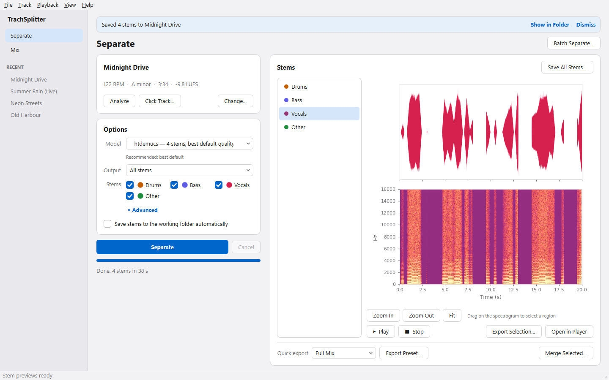
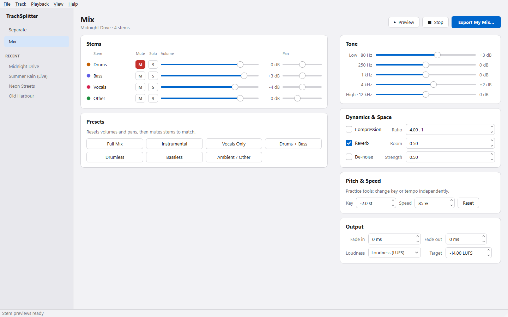
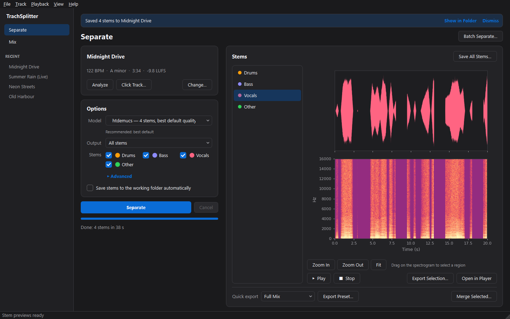
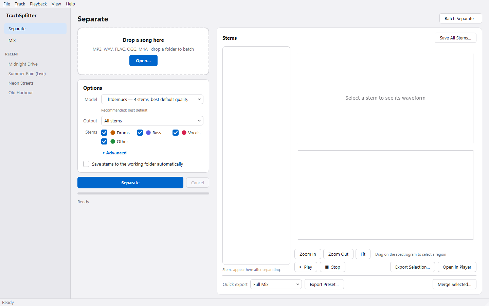
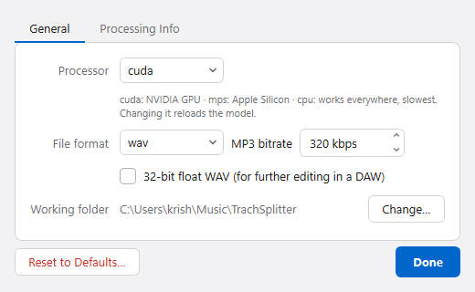

# TrachSplitter

> AI stem separation and mixing on your own computer, powered by Meta's [Demucs v4](https://github.com/facebookresearch/demucs).

Split any song into vocals, drums, bass, guitar, piano and other. Then remix the stems, change the key or speed, hit a streaming loudness target and export. Everything runs locally; your audio never leaves your machine.

---

## Screenshots

**Separate**: drop a song, pick a model, separate. Each stem keeps its own colour across the list, the waveform and the mixer.



**Mix**: volume, mute, solo and pan per stem, presets, 5-band EQ, dynamics, pitch & speed, loudness. **Export My Mix…** saves exactly what you hear.



**Dark mode** follows your system appearance automatically.



<details>
<summary>More: first launch and Settings</summary>





</details>

---

## Features

### Separation
| | |
|---|---|
| **8 Demucs models** | htdemucs, htdemucs_ft, htdemucs_6s, hdemucs_mmi, mdx, mdx_extra, mdx_q, mdx_extra_q |
| **Up to 6 stems** | Vocals · Drums · Bass · Guitar · Piano · Other |
| **Two-stem mode** | One stem + everything else, e.g. acapella + karaoke backing track |
| **Batch processing** | Pick many files or drop a folder; each track's stems go to their own folder |
| **Cancel + ETA** | Live progress with time remaining; cancel any time (Esc) |
| **Auto-save** | Optionally write stems to `<working folder>/<track>/` after every separation |
| **GPU acceleration** | NVIDIA CUDA, Apple Silicon (MPS), or CPU |

### Mixing & effects
| | |
|---|---|
| **Stem mixer** | Volume · Mute · Solo · constant-power Pan per stem |
| **Presets** | Full Mix · Instrumental · Vocals Only · Drums + Bass · Drumless · Bassless · Ambient |
| **Tone** | 5-band EQ (low/high shelves + peaking mids) |
| **Dynamics & space** | Compression · Reverb · De-noise (spectral gate) |
| **Pitch & speed** | Transpose ±12 semitones, 25–200 % tempo, independently: a practice tool |
| **Loudness** | Peak normalize, or LUFS loudness target (−14 Spotify/YouTube, −16 Apple Music) with a true limiter |
| **Fades** | Fade in / fade out |

### Analysis & export
| | |
|---|---|
| **Track analysis** | BPM, musical key, integrated loudness (LUFS) |
| **Click track** | Metronome aligned to the detected beats |
| **Waveform + spectrogram** | Click to seek, drag to select, **Export Selection** |
| **Formats** | WAV (16-bit or 32-bit float) · FLAC · OGG · MP3 (128–320 kbps) |
| **In-app playback** | Play stems or a rendered mix preview with a live playhead |

### App
- Sidebar navigation with recent files, full menu bar with keyboard shortcuts (F1 lists them)
- Light and dark appearance following the system, accessible contrast (≥ 4.5:1 text)
- Inline notifications with **Show in Folder** instead of pop-ups
- Drag & drop files or folders anywhere on the window
- Works without FFmpeg for WAV / FLAC / OGG / MP3 input

---

## Quick Start

### Run from source

```bash
pip install -r requirements.txt
python main.py
```

1. **Separate**: drop a song (or **Open…**, Ctrl+O), choose a model, click **Separate** (Ctrl+Enter).
2. Click a stem to see its waveform; **Play** (Space) to listen.
3. **Save All Stems…** or **Quick export** a preset (Instrumental, Vocals Only, …).
4. **Mix** (Ctrl+2): balance stems, add effects, then **Export My Mix…** (Ctrl+E).

### Keyboard shortcuts

| Action | Shortcut |
|---|---|
| Open file | Ctrl+O |
| Separate / Cancel | Ctrl+Enter / Esc |
| Batch separate | Ctrl+B |
| Play / Stop | Space |
| Preview mix | Ctrl+P |
| Save (mix on Mix page, otherwise stems) | Ctrl+S |
| Export my mix | Ctrl+E |
| Save all stems | Ctrl+Shift+S |
| Analyze track | Ctrl+I |
| Separate / Mix page | Ctrl+1 / Ctrl+2 |
| Settings | Ctrl+, |

### CLI

```bash
# Separate a single file (stems in separated/<model>/<track>/)
python cli.py separate track.mp3 --model htdemucs -f flac

# Karaoke: vocals + no_vocals (instrumental)
python cli.py karaoke track.mp3 -f mp3

# Tempo, key, loudness (+ optional click track)
python cli.py analyze track.mp3 --click click.wav

# Mix stems: gains, mutes, loudness target
python cli.py mix ./separated/htdemucs/track -o mix.wav -g drums:3 --mute vocals --lufs -14

# Batch a folder (recursive, skip tracks already done)
python cli.py batch ./songs -o ./stems -m htdemucs_ft -r --skip-existing
```

`--device` defaults to the best available (cuda → mps → cpu).

---

## Models

| Model | Stems | Speed | Notes |
|-------|-------|-------|-------|
| `htdemucs` | 4 | Fast | **Recommended default** |
| `htdemucs_ft` | 4 | Slow | Highest quality |
| `htdemucs_6s` | 6 | Slow | Adds guitar & piano |
| `hdemucs_mmi` | 4 | Medium | Stable alternative |
| `mdx` | 4 | Fast | Lightweight |
| `mdx_extra` | 4 | Medium | Better MDX |
| `mdx_q` | 4 | Fast | Quantized, low memory |
| `mdx_extra_q` | 4 | Fast | Smallest |

Models download automatically on first use (~80–320 MB each) and are cached in `~/.cache/torch/hub/`.

---

## Building the desktop app

Build on the platform you're targeting (no cross-compilation).

```bash
pip install pyinstaller

python build.py --no-package   # dist/TrachSplitter/ (fastest; use for testing)
python build.py                # + zip / dmg / tar.gz for sharing
python build.py --clean        # full clean rebuild (slower)
python build.py --onefile      # single-file executable
```

| Platform | Output |
|----------|--------|
| Windows | `dist/TrachSplitter/TrachSplitter.exe` (+ `dist/TrachSplitter-1.0.0-windows.zip`) |
| macOS | `dist/TrachSplitter.app` (+ `.dmg`) |
| Linux | `dist/TrachSplitter/TrachSplitter` (+ `.tar.gz`) |

Notes:
- Run the exe from `dist/`, not `build/` (the `build/` copy can't start on its own).
- Close the app before rebuilding; a running copy locks its files (the script checks for this).
- The build takes several minutes and the bundle is large (~4 GB with CUDA PyTorch). Both are expected.
- Logs: `~/.trachsplitter/app.log` (Help › Show Log Folder).

---

## Requirements

- Python 3.10+
- Optional: NVIDIA GPU + CUDA drivers, or Apple Silicon, for fast separation (CPU works, slower)
- Optional: FFmpeg on PATH for M4A/AAC input ([ffmpeg.org](https://ffmpeg.org/download.html))

---

## Project structure

```
TrachSplitter/
├── main.py                 # Entry point (dependency check → GUI)
├── gui.py                  # PySide6 desktop app
├── ui_theme.py             # Design tokens, light/dark stylesheet, stem colours
├── cli.py                  # Command-line interface
├── demucs_separator.py     # Demucs v4 wrapper (progress, cancel, fallback loading)
├── audio_editor.py         # Mixing, EQ, effects, limiter, loudness, export
├── audio_analysis.py       # BPM, key, LUFS (ITU-R BS.1770), click track
├── config.py               # Settings + model registry
├── build.py                # PyInstaller build script
└── requirements.txt
```

---

## License

MIT

## Acknowledgements

- [Demucs](https://github.com/facebookresearch/demucs): Meta AI Research
- [PySide6](https://doc.qt.io/qtforpython/): Qt for Python
- [librosa](https://librosa.org/), [SciPy](https://scipy.org/), [soundfile](https://github.com/bastibe/python-soundfile)
- [PyInstaller](https://pyinstaller.org/): packaging
